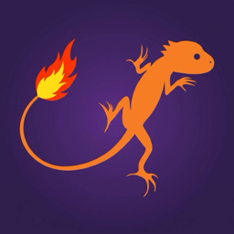

<p align="center"></p>

# Tr****net Quotes

An Android test assignment: a single Jetpack Compose screen (MVVM) showing a live quotes board in the style of the t*****net app, fed by the t*****net WebSocket API (`wss://wss.t*****net.com`).

## Features

- Live quotes table for a fixed ticker list, subscribed via `["quotes", [...]]`; `q` frames are parsed and merged per ticker (`min_step`, name and exchange arrive only in a ticker's first frame).
- Rows render immediately; a shimmer is shown only for fields that have no data yet.
- The percent-change badge flashes green or red for 300 ms when the last price ticks up or down.
- Prices and changes are rounded to the security's `min_step`.
- Company logos loaded from `https://t*****net.com/logos/get-logo-by-ticker?ticker=<lowercase ticker>`.
- Extra tickers from the top-securities REST endpoint (stocks, exchange `russia`, gainers `0`, limit 30).
- The socket is closed when the app goes to the background and survives rotation.
- Connection loss handling: automatic reconnect, then an error screen with "Try again" (details below).
- Localized strings: English (default) and Russian.

## Architecture

Package root: `com.grch.t*****nettestassignment`. The quotes feature is split into three layers.

```text
:app                           Hilt composition root (@HiltAndroidApp), theme, single activity
:feature:quotes:domain         Pure Kotlin/JVM: models, repository interfaces, FixedTickers
:feature:quotes:data           OkHttp WebSocket, Retrofit + Moshi REST, parsers, Hilt module
:feature:quotes:presentation   ViewModel, Compose UI, Coil logos
```

Dependencies point inwards: `presentation` and `data` depend on `domain`, and `:app` wires everything together.

## Tech stack

Kotlin, Jetpack Compose + Material 3, Hilt, Coroutines/Flow, OkHttp (WebSocket), Retrofit, Moshi, Coil 3. minSdk 28.

## Notable decisions

- **Top securities augment the fixed list instead of replacing it.** The fixed ticker list is a mandatory requirement, so tickers returned by the REST call are appended after it. If the call fails, the board silently falls back to the fixed list.
- **Connection loss.** The data layer reconnects automatically after a 2 s delay. After 3 consecutive failed attempts the UI shows an error screen with "Try again". Tapping it shows the dimmed board with a spinner until the connection is restored.
- **`min_step` rounding.** A price is rounded to the nearest multiple of `min_step` and shown with `min_step`'s own number of decimals. Because `min_step` arrives only in the first frame, it is kept per ticker across later partial updates. Without a `min_step`, the raw value is formatted.

## Build & test

```bash
./gradlew assembleDebug                # build the debug APK
./gradlew lint testDebugUnitTest       # lint + JVM unit tests (data, presentation)
./gradlew connectedDebugAndroidTest    # Compose UI tests (needs a device or emulator)
```

### Code quality

```bash
./gradlew detekt detektMain detektTest   # static analysis incl. Compose rules (reports only, never fails the build); reports in <module>/build/reports/detekt/
./gradlew buildHealth                    # unused or misdeclared dependencies; build/reports/dependency-analysis/build-health-report.txt
./gradlew koverHtmlReport koverLog       # JVM unit-test coverage, aggregated (koverLog prints a console summary); build/reports/kover/html/index.html
```

Unit-test coverage (debug unit tests; generated code, `ui.theme`, `@Composable` and `@Preview` code excluded): data 91.6% lines / 92.0% branches, presentation 89.6% lines / 85.9% branches, 90.9% lines overall. Compose UI is covered by instrumented tests (`connectedDebugAndroidTest`).
